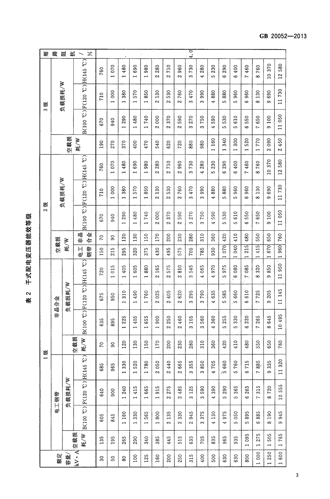
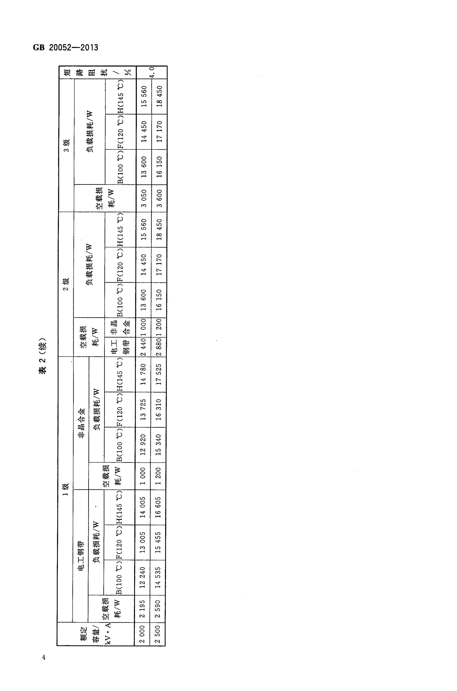
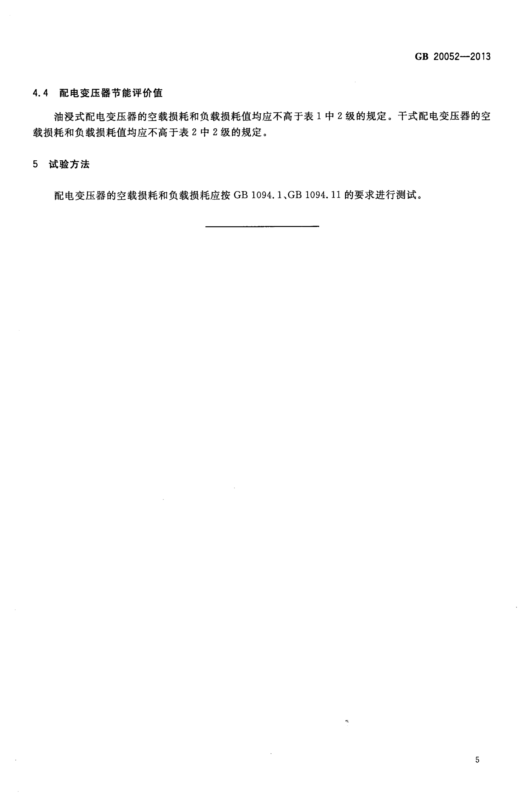

# 本地 OCR 表格重建评估

- 文件：/Users/littlesun/workspace/knowledge/标准/sources/f254dafd000e.pdf
- 页数：8（本次 5、6、7）
- 页面图目录：/Users/littlesun/.dsh/plugins/dsh-knowledge-base/docs/reports/f254dafd000e-pages

> 表格重建是启发式结果，需要对照页面图人工判断；非空单元格占比低通常意味着多级表头/合并单元格被拆成了空列。

## 第 5 页



- OCR 行数：26
- 检测表格块：4
- 表格行/单元格：15 / 311（非空 247，空单元格 21%）
- 被表格覆盖的 OCR 行：15/26

```html
GB 20052—2013

<table><tr><td>短路阻抗／%</td><td></td><td></td><td></td><td></td><td></td><td></td><td></td><td></td><td></td><td></td><td>o</td><td></td><td></td><td></td><td></td><td></td><td></td><td></td><td></td></tr><tr><td></td><td></td><td></td><td>760</td><td>1070</td><td>1480</td><td>1690</td><td>1980</td><td>2280</td><td>2710</td><td>2960</td><td>3730</td><td>4280</td><td>5230</td><td>6290</td><td>6400</td><td>7460</td><td>8760</td><td>10370</td><td>12580</td></tr><tr><td></td><td>负载损耗/W</td><td>(. H(.0(.00)</td><td>710</td><td>1000</td><td>1380</td><td>1570</td><td>1 850</td><td>2130</td><td>2530</td><td>2760</td><td>3470</td><td>3990</td><td>4880</td><td>5880</td><td>096S</td><td>0969</td><td>8130</td><td>0696</td><td>11 730</td></tr></table>

3级

<table><tr><td></td><td></td><td></td><td></td><td>670</td><td>940</td><td>1290</td><td>1480</td><td>1740</td><td>2000</td><td>2370</td><td>2590</td><td>3270</td><td>3750</td><td>4590</td><td>5530</td><td>5610</td><td>6550</td><td>7650</td><td>9100</td><td>11 050</td></tr><tr><td></td><td>空载损</td><td>耗/W</td><td></td><td>190</td><td>270</td><td>370</td><td>400</td><td>470</td><td>540</td><td>620</td><td>720</td><td>880</td><td>980</td><td>1160</td><td>1340</td><td>1300</td><td>1520</td><td>1770</td><td>2090</td><td>2450</td></tr><tr><td></td><td></td><td></td><td></td><td>760</td><td>1070</td><td>1 480</td><td>1690</td><td>1980</td><td>2280</td><td>2710</td><td>2960</td><td>3730</td><td>4280</td><td>5230</td><td>6290</td><td>6400</td><td>7460</td><td>8760</td><td>10370</td><td>12580</td></tr><tr><td>负载损耗/W</td><td></td><td></td><td>(0. SH(. 0)(.00)</td><td>710</td><td>1000</td><td>1380</td><td>1570</td><td>1850</td><td>2130</td><td>2530</td><td>2760</td><td>3470</td><td>066</td><td>4880</td><td>5880</td><td>096S</td><td>0969</td><td>8130</td><td>0696</td><td>11730</td></tr></table>

2级

<table><tr><td></td><td></td><td></td><td></td><td></td><td>670</td><td>940</td><td>1290</td><td>1 480</td><td>1740</td><td>2000</td><td>2370</td><td>2590</td><td>3270</td><td>3750</td><td>4590</td><td>5530</td><td>5610</td><td>6550</td><td>7650</td><td>9100</td><td>11050</td></tr><tr><td>干式配电变压器能效等级</td><td>空载损</td><td>耗/W</td><td>电工非晶</td><td>钢带合金</td><td>70</td><td>0</td><td>120</td><td>130</td><td>150</td><td>170</td><td>200</td><td>230</td><td>280</td><td>310</td><td>360</td><td>070420</td><td>410 040</td><td>215480</td><td>415550</td><td>1670650</td><td></td></tr><tr><td></td><td></td><td></td><td></td><td></td><td>150</td><td>215</td><td>295</td><td>320</td><td>375</td><td>430</td><td>495</td><td>575</td><td>705</td><td>785</td><td>930</td><td></td><td></td><td></td><td></td><td></td><td>11 9501 960760</td></tr><tr><td></td><td></td><td></td><td></td><td></td><td>720</td><td>1 015</td><td>1405</td><td>1605</td><td>1880</td><td>2165</td><td>2575</td><td>2810</td><td>3545</td><td>4065</td><td>4970</td><td>5975</td><td>6080</td><td>.7085</td><td>8320</td><td>9850</td><td></td></tr><tr><td>表2</td><td></td><td>负载损耗/W</td><td>(0. S)H( 0)(.00</td><td></td><td>675</td><td>950</td><td>1 310</td><td>1490</td><td>1760</td><td>2025</td><td>2405</td><td>2620</td><td>3295</td><td>3790</td><td>4635</td><td>5585</td><td>5660</td><td>6610°</td><td>7725</td><td>9205</td><td>11 145</td></tr></table>

非晶合金

635 895 1225 1405 1655 1900 2250 2460 3105 3560 4360 5255 5330 6.220 7265 8645 10495

空载损 耗/W 7 9 120 130 150 170 200 230 280 310 360 420 410 480 550 650 760

1级

685 965 1330 1520 1780 2050 2440 2665 3355 3850 4705 5660 5760 6715 7885 9335 11 320

负载损耗/W (0, SI)H(O. 0ZT)(O, 00I)| M/ 640 006 1240 1 415 1665 1915 2275 2485 3125 3590 4390 5290 5365 6265 7315 8720 10 555

电工钢带

<table><tr><td></td><td></td><td>605</td><td>845</td><td>1160</td><td>1330</td><td>1565</td><td>1800</td><td>2135</td><td>2330</td><td>2945</td><td>3375</td><td>4130</td><td>4975</td><td>5050</td><td>5895</td><td>6885</td><td>8190</td><td>9945</td></tr><tr><td></td><td>kV·A空载损</td><td>135</td><td>195</td><td>265</td><td>290</td><td>340</td><td>385</td><td>445</td><td>515</td><td>635</td><td>705</td><td>835</td><td>965</td><td>935</td><td>1095</td><td>1275</td><td>12501505</td><td>16001765</td></tr><tr><td>额定</td><td>容量/</td><td>30</td><td></td><td>80</td><td>100</td><td>125</td><td>160</td><td>200</td><td>250</td><td>315</td><td>400</td><td>500</td><td>630</td><td>630</td><td>800</td><td>000</td><td></td><td></td></tr></table>

3
```

## 第 6 页



- OCR 行数：20
- 检测表格块：2
- 表格行/单元格：14 / 98（非空 44，空单元格 55%）
- 被表格覆盖的 OCR 行：14/20

```html
GB20052-2013

<table><tr><td>短路阻抗／%</td><td></td><td></td><td></td><td></td><td>4.0</td><td></td></tr><tr><td></td><td></td><td></td><td></td><td>15560</td><td></td><td>18450</td></tr><tr><td>3级</td><td>负载损耗/W</td><td></td><td></td><td>14450</td><td></td><td>17170</td></tr><tr><td></td><td></td><td></td><td></td><td>13600</td><td></td><td>16150</td></tr><tr><td></td><td></td><td>空载损</td><td>耗/W</td><td>3050</td><td></td><td>3600</td></tr><tr><td></td><td></td><td></td><td></td><td>15560</td><td></td><td>18450</td></tr><tr><td></td><td>负载损耗/W</td><td></td><td></td><td>14450</td><td></td><td>17170</td></tr></table>

2级

13600

空载损 耗/W 电工非晶 钢带合金 2880120016150

表2 (续) 147802440|1000

17525

<table><tr><td></td><td>非晶合金</td><td>负载损耗/W</td><td></td><td>(0. S)H(. 0Z)(. 00)| M/</td><td>13725</td><td>16 310</td></tr><tr><td></td><td></td><td></td><td></td><td></td><td>12920</td><td>15340</td></tr><tr><td>1级</td><td></td><td></td><td>空载损</td><td></td><td>1000</td><td>1200</td></tr><tr><td></td><td></td><td></td><td></td><td></td><td>14005</td><td>16605</td></tr><tr><td></td><td>电工钢带</td><td>负载损耗/W</td><td></td><td>(0. S)H(. 0Z)H(0. 00) M/</td><td>13005</td><td>15 455</td></tr><tr><td></td><td></td><td></td><td></td><td></td><td>12240</td><td>14535</td></tr><tr><td></td><td>额定</td><td>容量/</td><td>kV·A空载损</td><td></td><td>20002195</td><td>25002590</td></tr></table>
```

## 第 7 页



- OCR 行数：6
- 检测表格块：0
- 表格行/单元格：0 / 0（非空 0，空单元格 0%）
- 被表格覆盖的 OCR 行：0/6

（未检测到表格块）

## 结论

- **“规则表格”指**：横平竖直、单元格边界清晰、列数不多（约 2–8 列）、表头只有一层、没有合并单元格/旋转排版，且单元格文字较短。合成样张（4 行 × 3 列）能正确重建。
- **真实标准表格**（本次 GB 20052-2013 第 5–7 页）：
  - 第 5 页表 1：被拆成 4 个块、15 行 / 311 格，21% 空单元格，只覆盖 15/26 个 OCR 行——多级表头被拆成了空列，结构不正确；
  - 第 6 页表 2/3：2 个块、14 行 / 98 格，55% 空单元格，结构明显失真；
  - 第 7 页竖排/旋转表：未识别到表格。
- **决定**：`ocrLayout=table` 继续作为**实验开关、默认关闭**，只在用户确认某类页面是规则表格时手动开启；不设为默认，避免把合并单元格/多级表头/旋转表拆成错表，污染正文与检索。
- 若要把它做成默认能力，下一步需要：多级表头识别、合并单元格合并、旋转页检测，以及至少 20–30 页人工标注样本的准确率基线；当前实现还不够。
